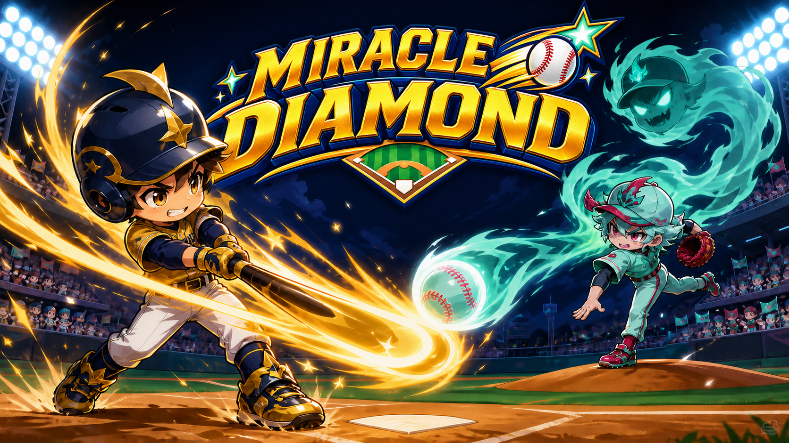

# MIRACLE DIAMOND / ミラクル・ダイヤモンド

短い3イニングに打撃、投球、走者、必殺技、逆転演出を詰め込んだ、1人用2Dアーケード野球ゲームです。外部アセットやSteamworks SDKに依存せず、Unity標準APIだけで動作します。

## 現在入っているもの

- タイトル → 遊び方 → 3イニング戦 → 結果 → 再戦の一連の流れ
- 打者と投手の左右移動、打撃タイミング、3球種、投球後の変化
- ボール、ストライク、アウト、走者進塁、押し出し、得点、延長、サヨナラ
- 攻守それぞれの必殺技とライバル側の必殺技
- ヒット、本塁打、画面揺れ、フラッシュ、パーティクル、合成効果音・BGM
- 音量、フルスクリーン、画面揺れ、フラッシュ軽減の設定保存
- 試合、勝利、本塁打、最高得点、最長飛距離の戦績保存
- 3勝または秘密コマンドで解放される月影スタジアムと隠しチーム
- 勝つたびに3ライバルを巡るアーケードラダーと連勝記録
- キーボード、XInputゲームパッド／Steam Input経由のゲームパッド操作（メニューはマウスにも対応）

## 遊び始める

Unity Hubでこのフォルダーを Unity `6000.3.22f1`（Unity 6.3 LTS）として開き、`Assets/Scenes/Main.unity` を再生してください。タイトル画面から難易度を選ぶと3イニング戦を始められます。

## 操作

| 操作 | キーボード | XInput / Steam Input |
|---|---|---|
| 移動・選択 | 矢印 / WASD | 左スティック |
| 決定・打つ・投げる | Z / Space / Enter | A |
| 必殺技 | X / Shift | Y |
| 戻る・ポーズ | Esc | B |

攻撃では左右で打者を動かし、曲がる球筋を見ながら手元で打ちます。守備では投手位置と球種を決めて投げ、投球後も左右入力でボールを曲げられます。

## ライセンス

ソースコード、ゲーム内容、同梱画像は [LICENSE.txt](LICENSE.txt) のとおり All Rights Reserved です。Unity本体とUnity PlayerにはUnity Technologiesの各ライセンスが適用されます。
